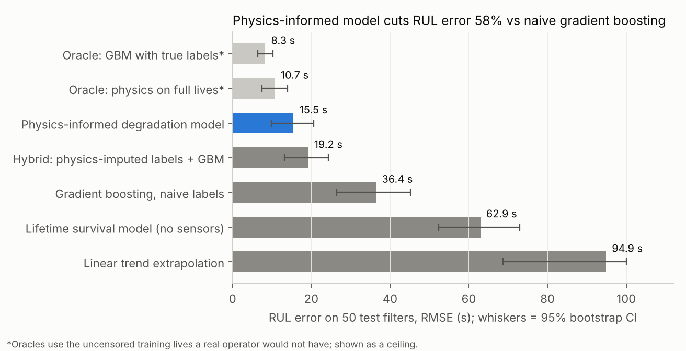
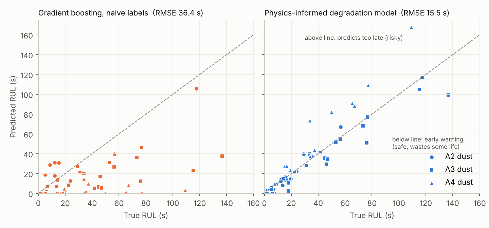
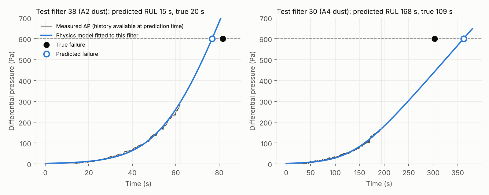
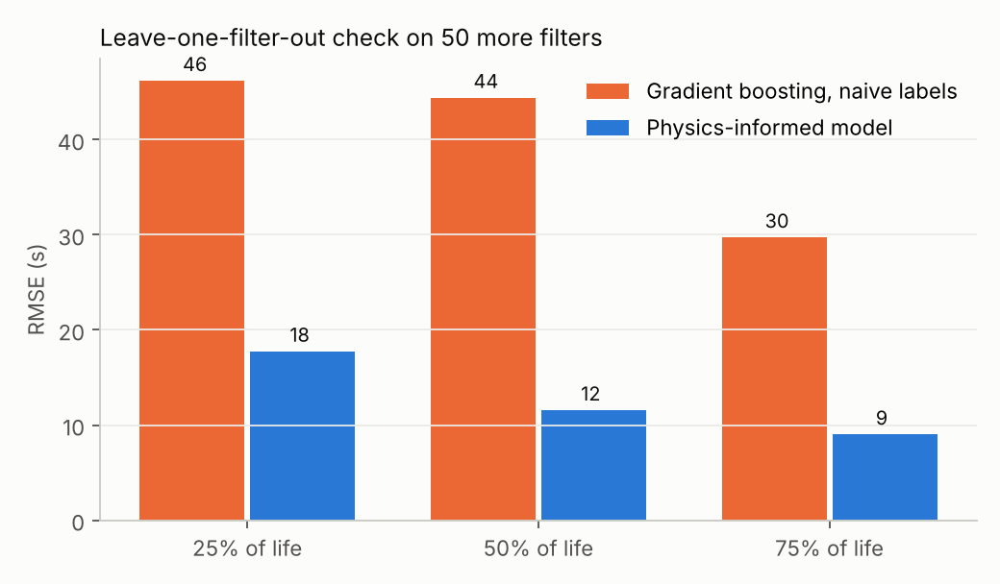

# Remaining-useful-life prediction for clogging filters from right-censored data

**Result:** a physics-informed degradation model predicts the remaining useful life (RUL) of 50 unseen filters with **RMSE 15.5 s** (95% CI 9.9–20.6 s). That is **58% lower error than gradient boosting trained the usual way** (36.4 s; 95% CI of the reduction 49–68%), using exactly the same censored training data. A leave-one-filter-out check on 50 further filters agrees: 13.3 s versus 40.8 s.

Dataset: Hagmeyer, S., Mauthe, F., & Zeiler, P. (2021). *Creation of Publicly Available Data Sets for Prognostics and Diagnostics Addressing Data Scenarios Relevant to Industrial Applications.* IJPHM 12(2). doi:10.36001/ijphm.2021.v12i2.3087 ("Preventive to Predictive Maintenance" set).

## The problem

A filter fails when its differential pressure reaches 600 Pa. In the training set, 50 filters were replaced on a fixed schedule, so **only 5 of the 50 ran to failure** (all with A2 fine dust). The other 45 are right-censored: we know they lasted *at least* until replacement, but not when they would have failed. The task is to predict RUL for 50 test filters, each observed up to a random point in its life.

## Approach

1. **Model the degradation signal rather than the failure-time labels.** Censoring hides *when* filters fail, but not *how their pressure rises*. Every training trajectory is therefore fully usable.
2. **Physics.** Pressure is modelled against cumulative dust mass *m* (from the logged feed rate and bulk density) as a smooth transition from depth filtration to cake filtration:
   `ΔP(m) = p₀ · softplus(K (m − m₀) / p₀)`, with `K = kᵢ · c_dust · (Q/60)^β`.
   At high load this becomes linear in deposited mass, as classical cake-filtration theory predicts. Population parameters (c, p₀ per dust; β) are fitted on all 50 censored training trajectories. Each filter has its own onset m₀ and rate multiplier kᵢ, with priors.
3. **Prediction.** For a new filter, infer (m₀, kᵢ) from its own history (MAP estimate), solve for the mass at which ΔP = 600 Pa, and convert to time.
4. **Honest model selection.** The one tuned hyperparameter (prior width on kᵢ) was chosen with a *label-free* leave-one-filter-out task on the training set: forecasting when each censored filter reaches its last observed pressure. The test set was touched once.

## Results on the official test set (50 filters)

| Model | RMSE (s) | 95% CI | MAE (s) | Median % error | Predictions >10 s late |
|---|---|---|---|---|---|
| **Physics-informed degradation model** | **15.5** | 9.9–20.6 | **9.4** | **21%** | 20% |
| Hybrid: physics-imputed lifetimes + gradient boosting | 19.2 | 13.2–24.3 | 11.7 | 21% | 26% |
| Gradient boosting, naive labels (replacement treated as failure) | 36.4 | 26.5–45.2 | 26.2 | 88% | 8% |
| Lifetime survival model (Weibull AFT, no sensor data) | 62.9 | 52.3–73.0 | 50.8 | 136% | 76% |
| Linear extrapolation of the filter's own trend | 94.9 | 68.7–117.6 | 61.4 | 120% | 68% |
| *Oracle: gradient boosting with true failure labels* | *8.3* | *6.4–10.2* | *6.3* | *19%* | *10%* |
| *Oracle: physics model fitted on full lives* | *10.7* | *7.5–14.0* | *7.6* | *18%* | *22%* |

The oracles use the uncensored versions of the training filters, which a real operator would not have. They show the ceiling, i.e. what censoring costs.




## What the results mean

- **Naive labels make models systematically pessimistic.** Treating replacement as failure teaches the model that filters die about 30% earlier than they do (replacement happens at ~70% of true life on average). Its predictions are mostly early (only 12% late), but it wastes a large share of useful life.
- **Lifetime-only survival analysis cannot work here.** With 5 failures, all from one dust type, the effect of dust type is unidentifiable: a dust-specific Weibull model diverges to infinite lifetimes for A3/A4. Sensor data is essential.
- **Physics fills the gap that censoring leaves.** No training filter of A3 or A4 dust was observed beyond about 470 Pa, yet the model must forecast to 600 Pa. The cake-filtration structure supplies that extrapolation.
- **Using physics to impute labels for ML (the hybrid) recovers most of the gap** (36.4 → 19.2 s), but the direct physics model is still better.

## Limitations (found, not hidden)

- **Coarse dust (A4) is the weak point:** RMSE 26.7 s versus 4.6 s for A2, with a +21 s late bias. Training never saw A4 above about 370 Pa, and the real curves keep steepening beyond the linear cake regime (compressible cake). See filter 30 in the figure below. A pressure-dependent cake resistance is the obvious next step. It was *not* added after seeing the test results, to avoid tuning on the test set.
- **Uncertainty is under-calibrated.** Nominal 90% intervals cover 30% of test cases. After conformal calibration on training residuals they cover 62%, still below 90%, because the calibration task (short-horizon forecasting) is easier than the test task (extrapolating to 600 Pa).
- **Sensitivity to the prior width:** test RMSE ranges from 10.6 to 22.6 s across plausible settings. Every setting beats naive gradient boosting, but the exact headline number depends on that one choice, which was made on training data.




## Reproduce

Run from the repository root (about 3 minutes on a laptop CPU):

```
pip install -r requirements.txt
PYTHONPATH=src python src/export_uncensored.py   # MATLAB table -> Data/Train_data_uncensored.csv
python src/run_all.py                            # all models on the official test set
python src/secondary_eval.py                     # uncertainty calibration + leave-one-filter-out check
python src/figures.py
```

| File | Purpose |
|---|---|
| `src/data.py` | Loads runs, converts feed rate to dust mass, removes a corrupted leading row in training run 28 |
| `src/physics.py` | Physics-informed degradation model (population fit, per-filter inference, RUL) |
| `src/baselines.py` | Gradient boosting, Weibull AFT, linear-trend baselines |
| `src/validate_physics.py` | Label-free hyperparameter selection on training data only |
| `src/run_all.py` / `src/secondary_eval.py` | Test-set evaluation; calibration and leave-one-out check |
| `src/matdecode.py`, `src/export_uncensored.py` | Read the MATLAB `table` in `Train_Data_Uncensored.mat` (used only for oracle and leave-one-out rows) |

## Version history

**v2 (current):** censoring-aware, physics-informed RUL modelling, evaluated on the dataset's official task (one prediction per test filter).

**v1 (`v1/`):** my first pass, kept for transparency. Re-evaluating it showed problems that v2 fixes:
- The final v1 model predicted current pressure headroom (600 − ΔP) rather than remaining life, and could reconstruct its own target exactly (`pressure_growth_rate × Time = ΔP`).
- `normalized_time` used each run's end time. At the prediction moment it always equals 1, so the v1 RUL model predicted **0 s remaining for every test filter** (RMSE 49.3 s on the official task).
- Replacement was treated as failure for 45 censored filters; a corrupted row in run 28 inflated its labels by about 97 s; train and test used different group bins.

## Author

Richard Olanite · Berm Engineering and Consulting Ltd · [github.com/thatboypage](https://github.com/thatboypage)
